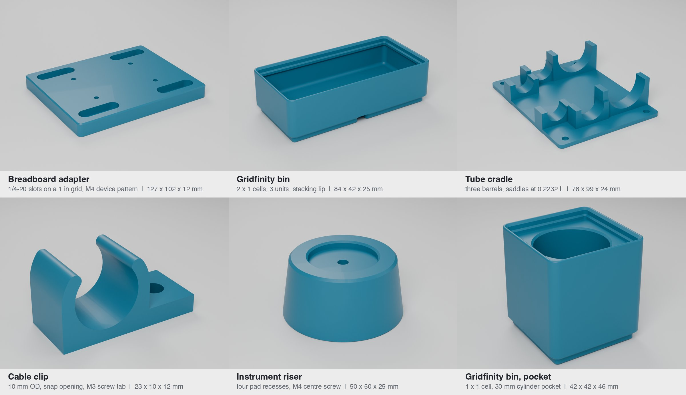

# benchtop-fixtures



Parametric, 3D-printable fixtures for the lab bench and workshop, written as Python with
[build123d](https://github.com/gumyr/build123d). Each part is a function of a few plain
parameters, is modeled in its print orientation, and goes through a printability checker before it
is exported as STEP and STL.

Built with AI coding agents; every part passes the printability checker and geometry tests.

## Parts

| Part | What it is | Main parameters (defaults) |
| --- | --- | --- |
| `breadboard_adapter` | Plate that bolts to an optical breadboard through counterbored clearance slots and carries a device on a rectangular bolt pattern with nut traps underneath. | `system` `"imperial"` (1/4-20 on a 25.4 mm grid) or `"metric"` (M6 on 25 mm); `units` (5, 4) grid pitches; `thickness` 12; `slot_fit` `"normal"`; `device_pattern` (60, 40); `device_screw` `"M4"`; `device_fit` `"close"`; `nut_traps` True |
| `gridfinity_bin` | Gridfinity-compatible bin: standard 42 mm base profile and stacking lip, N x M cells, 7 mm height units. Optional solid fill with a box or cylinder pocket. | `cells_x` 2; `cells_y` 1; `units` 3; `wall` 1.2; `lip` True; `pocket` None, `"box"` or `"cylinder"`; `pocket_size` (30, 20); `pocket_d` 20; `pocket_depth` 10 |
| `tube_cradle` | Cradle for syringes or tubes, laid out from a list of barrel diameters and lengths. Two saddles per barrel at the minimum-sag support points. | `barrels` ((14, 80), (17, 120), (29.5, 115)) as (OD, length); `clearance` 0.4; `wrap_deg` 200; `support_at` 0.2232; `mount_screw` `"M4"` |
| `cable_clip` | C-clip for a cable or tube of a given OD, with a snap opening and a flat adhesive base, or a screw tab. | `od` 6; `clearance` 0.3; `wall` 2; `opening` 0.8 (x OD); `style` `"snap"` or `"screw"`; `screw` `"M3"`; `fit` `"normal"`; `tabs` 1 |
| `instrument_riser` | Tapered foot or riser with anti-slip pad recesses underneath, a locating cup on top and an optional centre screw. | `shape` `"round"` or `"square"`; `size` 50; `height` 25; `taper_deg` 8; `pads` 4; `pad_d` 9.5; `pad_thickness` 2; `cup_d` 28; `screw` `"M4"` |

Every length is in millimetres. The full parameter list of each part is in its docstring, for
example `help(benchtop_fixtures.tube_cradle)`.

### Presets

Ten named configurations are built, checked and exported to `exports/` (STEP and STL), with every
check result in `exports/report.json`. Each has a render in `renders/`.

| Preset | Overrides | Size (mm) |
| --- | --- | --- |
| `breadboard_adapter` | | 127.0 x 101.6 x 12.0 |
| `breadboard_adapter_metric` | `system="metric"` | 125.0 x 100.0 x 12.0 |
| `gridfinity_bin` | | 83.5 x 41.5 x 24.6 |
| `gridfinity_bin_cylinder_pocket` | 1 x 1 cell, 6 units, 30 mm cylinder pocket 30 deep | 41.5 x 41.5 x 45.6 |
| `gridfinity_bin_box_pocket` | 70 x 28 mm box pocket, 10 deep | 83.5 x 41.5 x 24.6 |
| `tube_cradle` | | 77.7 x 98.9 x 23.5 |
| `cable_clip` | | 10.3 x 10.0 x 8.5 |
| `cable_clip_screw` | `style="screw"`, `od=10` | 22.7 x 10.0 x 11.7 |
| `instrument_riser` | | 50.0 x 50.0 x 25.0 |
| `instrument_riser_square` | `shape="square"`, `size=60`, `height=40` | 60.0 x 60.0 x 40.0 |

## Generate and check a part

```sh
python -m venv .venv && . .venv/bin/activate
pip install -r requirements.txt

# check any part or preset with parameter overrides (values are Python literals)
python -m benchtop_fixtures.check gridfinity_bin --set cells_x=3 --set units=4
python -m benchtop_fixtures.check tube_cradle --set "barrels=[(16, 90), (29.5, 115)]" --export out/

# rebuild every preset: check, STEP, STL and exports/report.json
python -m benchtop_fixtures.build

pytest -q
```

The checker prints one line per check and exits 0 for PASS, 1 for FAIL and 2 for FLAG:

```text
gridfinity_bin: PASS
  size 125.5 x 41.5 x 31.6 mm, volume 43.6 cm3
  [PASS] solid         1 solid, valid, watertight, 43.58 cm3
  [PASS] build_volume  fits Prusa MK4, Bambu Lab X1C, Formlabs Form 3
  [PASS] min_wall      thinnest 1.20 mm >= 1.2 mm (28280 samples)
  [PASS] holes         no screw holes declared
  [PASS] overhangs     2 flat bridge(s) flagged, longest span 3.5 mm <= 10; nothing else past 45 deg
```

From Python:

```python
from benchtop_fixtures import make
from benchtop_fixtures.check import check

fx = make("cable_clip", od=8.0, style="screw", screw="#8")
report = check(fx, min_wall=1.2, printers=["prusa_mk4"])
print(report.text())
fx.export("out", "clip_8mm")          # out/clip_8mm.step, out/clip_8mm.stl
```

## The printability checker

`benchtop_fixtures/check.py` measures the generated geometry; it does not trust the parameters.

| Check | How it works | Fails or flags when |
| --- | --- | --- |
| `solid` | One B-rep solid, valid, volume above zero; the tessellation is watertight with consistent winding and its volume matches the B-rep within 0.5 %. | Any of those is false. |
| `build_volume` | Bounding box in the modeled orientation against Prusa MK4 (250 x 210 x 220), Bambu Lab X1C (256 x 256 x 256) and Formlabs Form 3 (145 x 145 x 185), with a 90 degree turn about Z allowed. Diagonal placement is not tried. | A required printer does not fit. All three are required unless `--printer` narrows the list. |
| `min_wall` | About one sample per mm² of surface (4 000 to 60 000). From each sample a ray goes inward along the facet normal and is intersected with the exact B-rep; entry to exit is the local thickness. A short ray counts as a wall only if the face it leaves through is within 60 degrees of facing it, so a wall or a knife edge counts and a blunt corner does not. | Any wall sample is thinner than the minimum (default 1.2 mm) less 0.05 mm. |
| `holes` | Each part declares its screw holes (size, fit, axis). The smallest concave cylinder on that axis in the B-rep is the clearance bore; its diameter is compared with the table. | Not found, or more than 0.01 mm off the table. |
| `overhangs` | Approximate, aimed at FDM. A facet overhangs when its exact B-rep normal points down more than 45 degrees from vertical and it is not on the bed. Overhanging facets are grouped into regions. The span of a region is twice the largest distance from any point of it to an edge that has material below it. Flat regions with a span up to 10 mm are listed as bridges and accepted. | Anything else is flagged as needing support (verdict FLAG). |

The screw table covers M3, M4, M6, #8 and 1/4-20 in close and normal fit:

| Screw | Close (mm) | Normal (mm) |
| --- | --- | --- |
| M3 | 3.20 | 3.40 |
| M4 | 4.30 | 4.50 |
| M6 | 6.40 | 6.60 |
| #8 | 4.572 (0.180 in) | 4.978 (0.196 in) |
| 1/4-20 | 6.747 (17/64 in) | 7.144 (9/32 in) |

Known limits: the overhang check does not know about bridging direction or slicer settings, and
it does not prove that a bridge is anchored at both ends beyond the supported-edge test above. The
wall check samples, so a feature smaller than about 1 mm² can be missed. Resin printers have
different overhang rules; the Form 3 entry is for build volume only.

## Design notes

These are the design-for-printing choices built into the defaults.

- **Print orientation is the model orientation.** Every part sits on the bed at z = 0 the way it
  should be printed, so the checker's overhang and build-volume results apply directly.
- **Elephant's foot.** Plates, the cradle base and the riser get a 0.4 mm chamfer on the bottom
  edge. It is exactly 45 degrees, so it never counts as an overhang.
- **Screw holes stay vertical and come from a table.** All clearance holes print as vertical
  cylinders, which come out round. Diameters are the ASME B18.2.8 close or normal values, not
  hand-tuned numbers. If your printer runs holes small, use the slicer's hole compensation or the
  normal fit; the checker flags a hand-edited diameter on purpose.
- **Pockets from below are short bridges.** Nut traps under the breadboard adapter, the riser's
  counterbore and its pad recesses are flat ceilings. They are sized to stay at or under a 10 mm
  span, and the checker lists each one.
- **Breadboard slots.** Each slot is centred between two breadboard holes with one full pitch of
  travel, so the plate can be placed anywhere along the slot axis and still land on a hole. The
  plate size is a whole number of pitches.
- **Snap clip.** The lip tips sit at least 45 degrees from the top of the ring, so the inside of
  the ring is self-supporting. The tips are full rounds instead of sharp ends, and the opening
  defaults to 0.8 x OD for retention. Ask for a narrower opening and the checker flags it.
- **Cradle.** Saddles wrap 200 degrees for a light snap and sit at 0.2232 L from each barrel end,
  the support points that minimise sag of a uniformly loaded beam.
- **Gridfinity.** Walls are 1.2 mm (three 0.4 mm lines) instead of the common 0.95 mm, so the
  bin clears the default minimum wall. The lip's top edge is rounded to 0.6 mm, half the minimum
  wall, as in the reference implementation. Pocket bins fill to 1.2 mm under the lip so a stacked
  bin still seats, and a test stacks two bins to prove it.
- **Riser.** An 8 degree draft keeps the sides self-supporting; adhesive pads stand 0.8 mm proud
  of their recesses.
- **Minimum wall.** 1.2 mm by default, three perimeters with a 0.4 mm nozzle. Pass
  `--min-wall 0.8` for two.

## Sources

- **Gridfinity** is the open modular storage system created by Zack Freedman. Profile numbers
  (42 mm pitch, 7 mm units, base 0.8 / 1.8 / 2.15 mm, lip 0.7 / 1.8 / 1.9 mm, 41.5 mm top with
  3.75 mm corners) follow the community specification as encoded in
  [kennetek/gridfinity-rebuilt-openscad](https://github.com/kennetek/gridfinity-rebuilt-openscad),
  `src/core/standard.scad` (MIT), which cites [gridfinity.xyz/specification](https://gridfinity.xyz/specification/).
- **Clearance holes:** ASME B18.2.8-1999, inch and metric tables (the metric values match ISO 273).
- **Socket head cap screws:** ISO 4762, ASME B18.3. **Hex nuts:** ISO 4032, ASME B18.6.3 (#8),
  ASME B18.2.2 (1/4).
- **Breadboard grids:** the industry convention of 1/4-20 holes on a 1 in grid or M6 holes on a
  25 mm grid.
- **Printer build volumes:** manufacturer specifications.

## Repository layout

```text
benchtop_fixtures/
  parts/            one module per part
  standards.py      screw, Gridfinity, breadboard and printer tables, each with its source
  check.py          printability checker and command line
  build.py          builds, checks and exports every preset
exports/            STEP + STL per preset, report.json
renders/            one web-size render per preset, overview.jpg
render/             Blender render script and the overview sheet
tests/              pytest suite
ACCEPTANCE.md       acceptance criteria, written before the code
```

## Rebuilding the renders

Renders need Blender (tested with 5.1) and Pillow. `./make.sh` rebuilds exports, runs the tests,
renders every preset with Cycles into `renders/_work/` (full-size masters, not committed), then
writes the web-size JPEGs and `renders/overview.jpg`. `./make.sh --no-render` stops after the
tests.

## License

MIT. See [LICENSE](LICENSE).
